  

# 🎓 Awesome Developer Education & Skills 🚀

  
  
  
  
  
  

  <strong>A curated collection of elite developer education platforms, self-directed open-source curricula, computer science roadmaps, hands-on practice sandboxes, and agent-native engineering skill libraries.</strong>

  <em>Level up from syntax familiarity to high-velocity software engineering, production architecture, and AI-assisted workflows.</em>

---

## 📌 Table of Contents

- [📊 Sector Overview & Market Dynamics](#-sector-overview--market-dynamics)
- [🏢 SaaS & Hosted Platforms](#-saas--hosted-platforms)
- [🌐 Open-Source GitHub Projects](#-open-source-github-projects)
- [🤝 How to Contribute](#-how-to-contribute)
- [💖 Support & Sponsorship](#-support--sponsorship)
- [📈 Star History](#-star-history)
- [⚠️ Disclaimer](#️-disclaimer)

---

## 📊 Sector Overview & Market Dynamics

The global developer and programming education market is estimated at approximately **$70B–$75B** and projected to expand past **$250B by the mid-2030s** (~15% CAGR). The sector exhibits a distinct hybrid structure: it is **highly fragmented** across individual tutorial creators, niche bootcamps, and community repositories at the consumer/entry-level, yet **moderately concentrated** among enterprise-scaled B2B platforms where accredited credentials, telemetry dashboards, and multi-tenant organizational compliance dominate procurement.

---

## 🏢 SaaS & Hosted Platforms

| Company / Platform | Company Size (Revenue / Valuation) | Pricing (Starting Tier) | Free Tier Limits / Free Trial | Description |
| :--- | :--- | :--- | :--- | :--- |
| **LinkedIn Learning** | ~$2.1B–$2.5B ARR (Parent Microsoft: ~$3T+ market cap) | $29.99/month (or $19.99/mo billed annually at $239.88/yr) | 30-day free trial; full library access of 25,000+ courses; auto-renews unless cancelled. | Professional development and software engineering video courses integrated directly with LinkedIn profiles. |
| **Pluralsight** | ~$3.5B valuation (Vista acquisition 2021; ~$400M–$470M ARR) | $29/month (or $299/year Core tech plan) | 10-day free trial; provides individual access to core library; limited offline downloads and cloud sandbox caps. | Technology skills platform with skill assessments, learning paths, Iris AI assistant, and Skill IQ measurements. |
| **A Cloud Guru** | ~$2B+ valuation (acquired by Pluralsight; ~$100M+ ARR) | $29/month (or $299/year Cloud+ plan) | 10-day free trial; access to core cloud courses; temporary pre-auth hold required; certain advanced sandboxes restricted during trial. | Cloud certification training with hands-on labs and sandbox environments across AWS, Azure, and Google Cloud. |
| **Coursera** | ~$1.3B market cap (COUR) / ~$1.22B–$1.24B annual revenue | $39/month (or $399/year for Coursera Plus) | Free forever Audit mode on individual courses (video streaming and reading materials only; no graded assignments, programming labs, or completion certificates). | University-backed AI and engineering education with Stanford, deeplearning.ai, and IBM specializations and professional certificates. |
| **Udemy Business** | ~$680M market cap (UDMY) / ~$780M–$810M annual revenue | $360/user/year ($30/seat/month, Team plan for 2–50 users) | 14-day free trial for Team Plan; access to curated catalog of 25,000+ courses and admin management tools. | Enterprise learning platform with curated technical and business learning paths, custom LMS integrations, and analytics. |
| **Codecademy Pro** | $525M valuation (acquired by Skillsoft in 2022) | $17.49/month billed annually ($29.99 billed monthly for Plus) | Free forever Basic plan limited to a small selection of introductory courses only; career paths, hands-on portfolio projects, interactive quizzes, and certificates locked. | Interactive coding platform with in-browser code execution for beginner-to-intermediate developers. |
| **QA / Cloud Academy** | ~$350M–$400M parent revenue (acquired by QA in 2019) | $35/month (or $399/year individual plan) | 7-day free trial; full access to self-paced courses, videos, and quizzes; advanced exam engines and live lab sandboxes may have usage caps. | Cloud and AI training platform with hands-on labs, role-based learning paths, and cloud certification prep. |
| **O'Reilly Learning** | ~$200M–$250M estimated annual revenue (Private) | $49/month (or $499/year) | 10-day free trial; full unlimited access to the catalog of books, video courses, and early-release titles; no credit card required upfront. | Technical reference library, digital books, video courses, live events, and interactive coding sandboxes. |
| **Skillsoft** | ~$52M–$55M market cap (SKIL) / ~$450M–$510M TTM revenue | $25/month (or $200–$240/user/year for Teams) | 30-day free trial for Percipio Teams platform; 45-day trial for individual learner accounts; unrestricted access to selected library tracks. | Enterprise learning platform with compliance, tech & dev, leadership training, and corporate skill tracking. |
| **Frontend Masters** | ~$6M–$8M estimated annual revenue (~100 employees, Bootstrapped) | $39/month (or $390/year) | Free forever account limited to ~5 foundational introductory web courses; verified students receive 6 months free via GitHub Student Developer Pack. | Advanced frontend development courses from industry leaders focusing on JavaScript, React, Node.js, and modern web architectures. |

---

## 🌐 Open-Source GitHub Projects

*Ranked strictly by GitHub Star count in descending order.*

1. ### [freeCodeCamp](https://github.com/freeCodeCamp/freeCodeCamp) 
   - **Focus**: Full-stack web development, algorithms, data structures, and hands-on coding certifications.
   - **Highlights**: The most accessible free curriculum on the web. Practice directly inside an interactive in-browser execution sandbox without needing local terminal setup. Rigorous JavaScript algorithm problem sets and full-stack project challenges.
   - **Best For**: Absolute beginners through intermediate learners seeking immediate coding validation and tangible certifications.

2. ### [free-programming-books](https://github.com/EbookFoundation/free-programming-books) 
   - **Focus**: Curated directory of free books, cheat sheets, podcasts, and courses across virtually every programming language.
   - **Highlights**: Maintained by the Free Ebook Foundation; multi-language directory covering low-level systems, web stacks, machine learning, and DevOps.
   - **Best For**: Self-directed developers who want comprehensive, cost-free technical reading across languages and paradigms.

3. ### [system-design-primer](https://github.com/donnemartin/system-design-primer) 
   - **Focus**: Large-scale distributed systems, system design interviews, scalability, and architectural fundamentals.
   - **Highlights**: Visual roadmaps, diagrams, code examples, and flashcards teaching how to design systems capable of scaling to millions of concurrent users.
   - **Best For**: Mid-level to senior developers preparing for technical system design interviews and distributed systems engineering.

4. ### [developer-roadmap](https://github.com/kamranahmedse/developer-roadmap) 
   - **Focus**: Interactive visual roadmaps, study guides, and milestone tracking (roadmap.sh).
   - **Highlights**: Community-standard visual guides covering Frontend, Backend, DevOps, AI/Data Engineering, and Cybersecurity.
   - **Best For**: Developers seeking a clear roadmap and structured path forward before plunging into deep technical documentation.

5. ### [coding-interview-university](https://github.com/jwasham/coding-interview-university) 
   - **Focus**: Multi-month computer science study plan to transition to software engineer roles at top tech companies.
   - **Highlights**: Deep coverage of data structures, Big-O algorithm analysis, bitwise operations, graph search, and systems concepts.
   - **Best For**: Non-CS graduates and self-taught software engineers aiming for FAANG/Big Tech engineering roles.

6. ### [mattpocock/skills](https://github.com/mattpocock/skills) 
   - **Focus**: Agent-native skill libraries, TDD workflows, and engineering alignment tools for AI coding assistants.
   - **Highlights**: Created by TypeScript educator Matt Pocock. Enforces real engineering rigor on LLM coding agents like Claude Code and Codex using commands like `/grill-me`, `/tdd`, and domain glossaries.
   - **Best For**: Modern software engineers pairing with agentic AI assistants who want disciplined test-driven development rather than vibe coding.

7. ### [project-based-learning](https://github.com/practical-tutorials/project-based-learning) 
   - **Focus**: Programming tutorials where learners build applications from scratch across multiple languages.
   - **Highlights**: Organized by programming language (Python, C++, Rust, JavaScript, Go) with practical build-it-yourself guides for web servers, 3D engines, compilers, and games.
   - **Best For**: Developers who learn by building real projects rather than following passive video walkthroughs.

8. ### [computer-science (OSSU)](https://github.com/ossu/computer-science) 
   - **Focus**: Complete, rigorous open-source curriculum for a self-taught undergraduate degree in Computer Science.
   - **Highlights**: Curated using MOOC courses from MIT, Harvard, Princeton, and UC Berkeley. Covers discrete math, algorithms, operating systems, and computer architecture.
   - **Best For**: Self-directed learners demanding rigorous computer science foundations equivalent to a four-year university program.

9. ### [javascript-algorithms](https://github.com/trekhleb/javascript-algorithms) 
   - **Focus**: Algorithms and data structures implemented in modern JavaScript with detailed explanations and README specs.
   - **Highlights**: Includes Big-O complexity labels, unit tests, and real-world implementation patterns for searching, sorting, graphs, and dynamic programming.
   - **Best For**: JavaScript and TypeScript developers wanting deep, algorithmic mastery in their native language ecosystem.

10. ### [nodebestpractices](https://github.com/goldbergyoni/nodebestpractices) 
    - **Focus**: Production engineering best practices, security, error handling, and code architecture for Node.js.
    - **Highlights**: Over 80 battle-tested best practices with code snippets, anti-patterns, and Docker/cloud deployment guidelines.
    - **Best For**: Backend engineers and full-stack developers taking Node.js applications into enterprise production.

11. ### [every-programmer-should-know](https://github.com/mtdvio/every-programmer-should-know) 
    - **Focus**: Collection of technical resources, mental models, and principles every software developer should understand.
    - **Highlights**: Covers floating-point arithmetic, Unicode encoding, timezones, security, memory hierarchy, and distributed consensus.
    - **Best For**: Engineers striving for technical excellence and deep understanding beyond basic syntax.

12. ### [java-design-patterns](https://github.com/iluwatar/java-design-patterns) 
    - **Focus**: Design patterns implemented in Java with comprehensive architectural rationale.
    - **Highlights**: Covers Gang of Four (GoF) design patterns, enterprise integration patterns, architectural styles, and idiomatic modern implementations.
    - **Best For**: Object-oriented developers and enterprise backend engineers.

13. ### [33-js-concepts](https://github.com/leonardomso/33-js-concepts) 
    - **Focus**: 33 JavaScript concepts every developer should master.
    - **Highlights**: Detailed exploration of call stack, primitive types, closures, event loop, promises, prototypes, and bitwise operators.
    - **Best For**: Frontend and full-stack JavaScript developers looking to master advanced language internals.

14. ### [professional-programming](https://github.com/charlax/professional-programming) 
    - **Focus**: Curated collection of mental models, resources, and engineering habits for professional programmers.
    - **Highlights**: Emphasizes code quality, observability, team collaboration, technical writing, and release management.
    - **Best For**: Software engineers transitioning into mid-level, senior, or tech lead positions.

15. ### [The Odin Project Curriculum](https://github.com/TheOdinProject/curriculum) 
    - **Focus**: Hands-on, unguided full-stack web development curriculum (Full-Stack JavaScript & Ruby on Rails).
    - **Highlights**: Emphasizes installing real developer tools (Git, terminal, VS Code), reading documentation, and building portfolio apps from specifications without handheld tutorials.
    - **Best For**: Self-motivated learners and career switchers prepared to build production-grade web applications from scratch.

16. ### [Exercism](https://github.com/exercism/exercism) 
    - **Focus**: Code practice and human mentorship in 70+ programming languages.
    - **Highlights**: Download exercises locally via CLI, pass unit test suites, and receive voluntary feedback from experienced software mentors.
    - **Best For**: Developers learning a new language who want code review and constructive human mentorship.

---

## 🤝 How to Contribute

Contributions make the open-source community thrive! Follow these steps to contribute:

1. 🍴 **Fork the Project**
2. 🔀 **Create your Feature Branch** (`git checkout -b feature/AmazingSkillPlatform`)
3. 📝 **Commit your Changes** (`git commit -m 'Add AmazingSkillPlatform'`)
4. 📤 **Push to the Branch** (`git push origin feature/AmazingSkillPlatform`)
5. 🚀 **Open a Pull Request** with a concise description of the resource, starting tier pricing, and free tier limits.

---

## 💖 Support & Sponsorship

If you find this repository helpful, consider supporting its maintenance!

- ⭐ **Star this repository** to show your appreciation and help other developers discover it!
- 🍴 **Fork and share** with colleagues, bootcamps, and developer communities.
- ☕ **Buy a coffee & sponsor ongoing work**: Visit the [GitHub Sponsors Dashboard](https://github.com/sponsors/ishandutta2007) to help support continuous curation and open-source contributions.

---

## 📈 Star History

---

## ⚠️ Disclaimer

- This is a **community-curated educational index** — not exhaustive and not an endorsement of specific commercial platforms.
- Developer education platforms should be evaluated based on **curriculum depth**, **practical problem solving**, **completion rates**, and **verifiable industry credentials**.
- **Video Course vs. Spec-Driven Engineering**: Video courses provide broad familiarity, while spec-driven projects (like *The Odin Project* or *Project-Based Learning*) develop hands-on engineering velocity and problem solving.
- **Agent-Native Skill Libraries**: Frontier tools like `mattpocock/skills` teach AI coding agents to test, align, and engineer with discipline rather than "vibe code".
- Self-paced solutions demand self-discipline and active practice. **The best curriculum is the one you complete and ship projects with.**

---

  <strong>Crafted for engineers, self-taught developers, and engineering teams building the future of software development.</strong>

